# Down In Bossa — reels & banners

**ACND × Ash Army · Down In Bossa · Profi Music · out 30.10.2026**
Listen: https://profimusic.lnk.to/DownInBossa

**Watch online:** https://ahmedmasum2000000.github.io/ACND/down-in-bossa/

Promo kit for the release: 15 vertical reels for TikTok / Instagram Reels / Shorts, each with the ACND and Ash Army logos and as a clean version without logos, plus 5 feed banners.

- Reels: 1080×1920, 30 fps, 15.7 s, H.264 + AAC, about 12 MB each
- Banners: 1080×1350 PNG
- Posting guide and captions: [TREND_KIT.md](TREND_KIT.md)

**Download:** each link opens the file directly (video or image) so you can save it. To grab everything at once, use **Code → Download ZIP** on the repository page.

## #BossaFreeze

At 0:45 the kick and bass cut out for one bar: freeze, then the drop hits and the frame bursts into the mirror kaleidoscope. Post with the official Profi Music sound starting at **0:39.6** so the freeze lands at the same moment for everyone.

## Reels

| Preview | Reel | | |
|---|---|---|---|
| 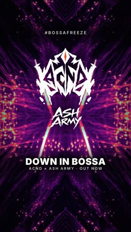 | **13 · #BossaFreeze · Trend** freeze at 5.9 s → kaleidoscope drop | [With logos](logos/DownInBossa_Reel13_BossaFreeze_Trend.mp4?raw=1) | [No logos](no_logo/DownInBossa_Reel13_BossaFreeze_Trend_NoLogo.mp4?raw=1) |
| 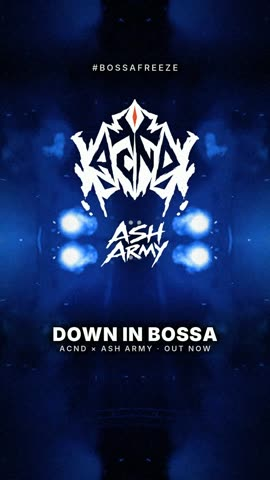 | **14 · #BossaFreeze · POV** "POV: you didn't freeze on the bossa break" | [With logos](logos/DownInBossa_Reel14_BossaFreeze_POV.mp4?raw=1) | [No logos](no_logo/DownInBossa_Reel14_BossaFreeze_POV_NoLogo.mp4?raw=1) |
| 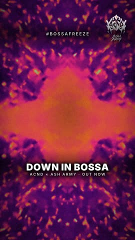 | **15 · #BossaFreeze · Green-screen template** 3·2·1 countdown, clean background | [With logos](logos/DownInBossa_Reel15_BossaFreeze_Template.mp4?raw=1) | [No logos](no_logo/DownInBossa_Reel15_BossaFreeze_Template_NoLogo.mp4?raw=1) |
| 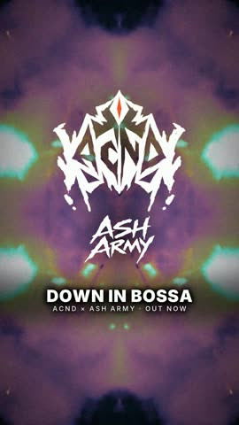 | **11 · Pyro Hits** fireworks kaleidoscope, freeze built in | [With logos](logos/DownInBossa_Reel11_PyroHits.mp4?raw=1) | [No logos](no_logo/DownInBossa_Reel11_PyroHits_NoLogo.mp4?raw=1) |
| 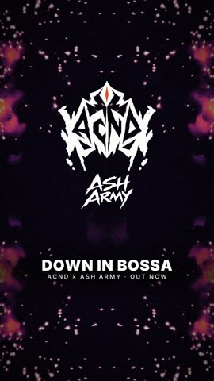 | **01 · Wait For The Drop** build → drop at 7.8 s | [With logos](logos/DownInBossa_Reel01_WaitForTheDrop.mp4?raw=1) | [No logos](no_logo/DownInBossa_Reel01_WaitForTheDrop_NoLogo.mp4?raw=1) |
| 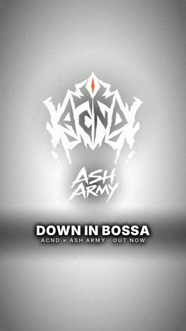 | **02 · Chrome Kaleido** blue chrome mirror, first drop | [With logos](logos/DownInBossa_Reel02_ChromeKaleido.mp4?raw=1) | [No logos](no_logo/DownInBossa_Reel02_ChromeKaleido_NoLogo.mp4?raw=1) |
| 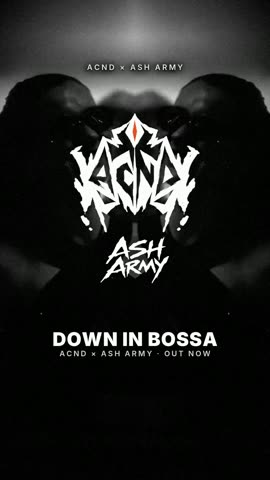 | **03 · Mono Rave** black-and-white rave, cuts on every beat | [With logos](logos/DownInBossa_Reel03_MonoRave.mp4?raw=1) | [No logos](no_logo/DownInBossa_Reel03_MonoRave_NoLogo.mp4?raw=1) |
| 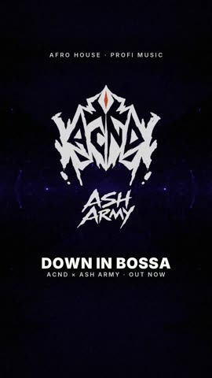 | **04 · Purple Void** slow violet intro | [With logos](logos/DownInBossa_Reel04_PurpleVoid.mp4?raw=1) | [No logos](no_logo/DownInBossa_Reel04_PurpleVoid_NoLogo.mp4?raw=1) |
| 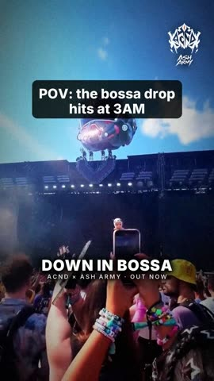 | **05 · POV 3AM** "POV: the bossa drop hits at 3AM" | [With logos](logos/DownInBossa_Reel05_POV3AM.mp4?raw=1) | [No logos](no_logo/DownInBossa_Reel05_POV3AM_NoLogo.mp4?raw=1) |
| 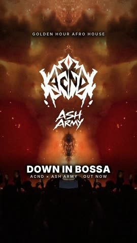 | **06 · Golden Hour** amber mirror, sunset dancers | [With logos](logos/DownInBossa_Reel06_GoldenHour.mp4?raw=1) | [No logos](no_logo/DownInBossa_Reel06_GoldenHour_NoLogo.mp4?raw=1) |
| 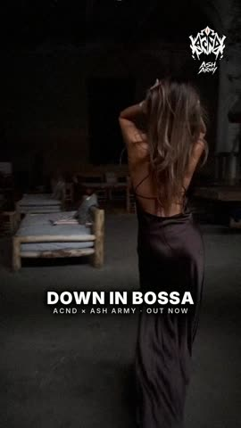 | **07 · Dance Mirror** dancer cuts, "on repeat all weekend" | [With logos](logos/DownInBossa_Reel07_DanceMirror.mp4?raw=1) | [No logos](no_logo/DownInBossa_Reel07_DanceMirror_NoLogo.mp4?raw=1) |
| 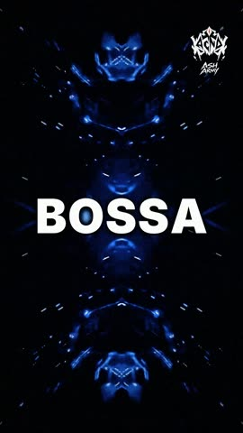 | **08 · Word Stack** one word per beat | [With logos](logos/DownInBossa_Reel08_WordStack.mp4?raw=1) | [No logos](no_logo/DownInBossa_Reel08_WordStack_NoLogo.mp4?raw=1) |
| 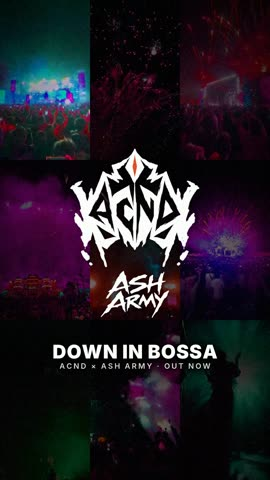 | **09 · Grid** 3×3 grid, one tile per beat | [With logos](logos/DownInBossa_Reel09_Grid.mp4?raw=1) | [No logos](no_logo/DownInBossa_Reel09_Grid_NoLogo.mp4?raw=1) |
| 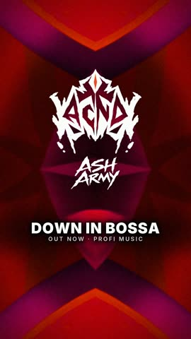 | **10 · Ink Reveal** cover art kaleidoscope → logo reveal | [With logos](logos/DownInBossa_Reel10_InkReveal.mp4?raw=1) | [No logos](no_logo/DownInBossa_Reel10_InkReveal_NoLogo.mp4?raw=1) |
| 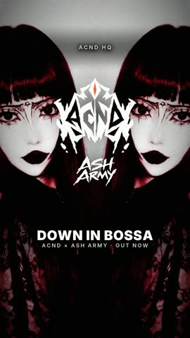 | **12 · Gothic Mirror** black, white and red mirror | [With logos](logos/DownInBossa_Reel12_GothicMirror.mp4?raw=1) | [No logos](no_logo/DownInBossa_Reel12_GothicMirror_NoLogo.mp4?raw=1) |

## Banners

| Preview | | |
|---|---|---|
| 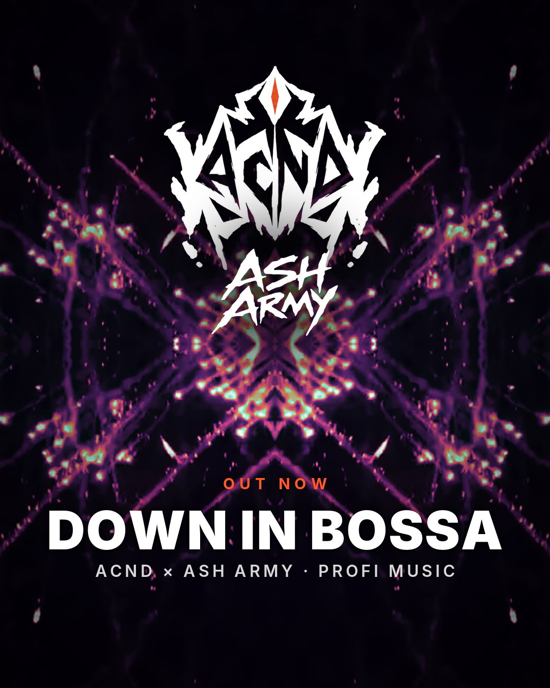 | [With logos](banners/post1.png?raw=1) | [No logos](banners/post1_nologo.png?raw=1) |
| 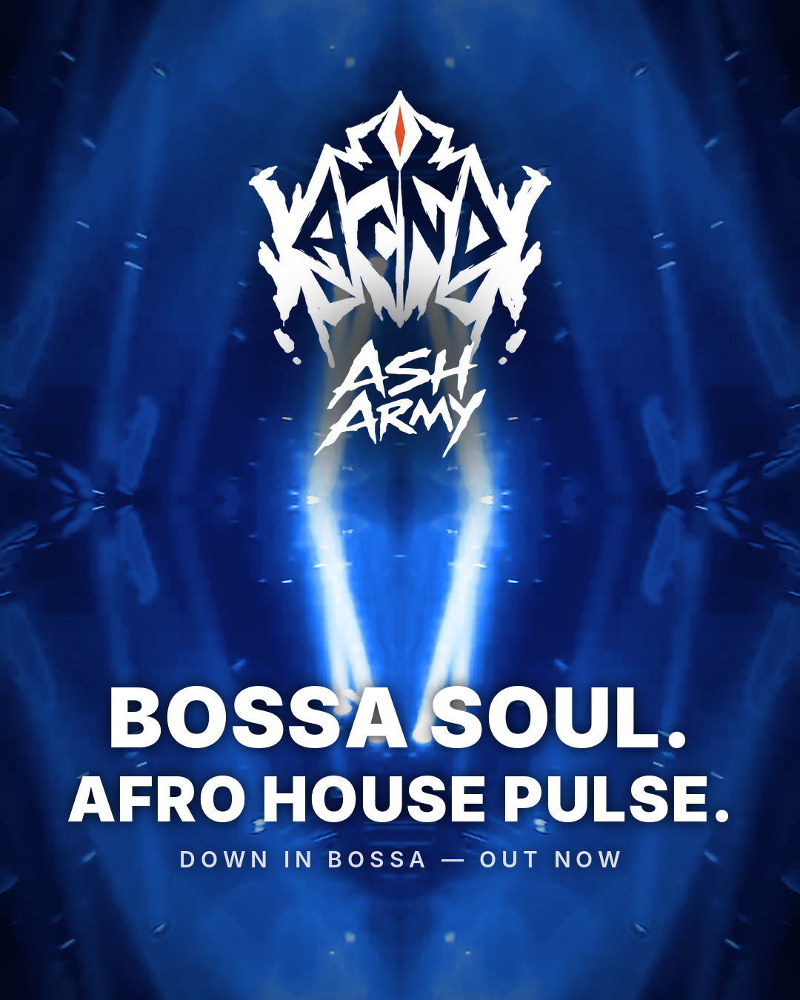 | [With logos](banners/post2.png?raw=1) | [No logos](banners/post2_nologo.png?raw=1) |
| 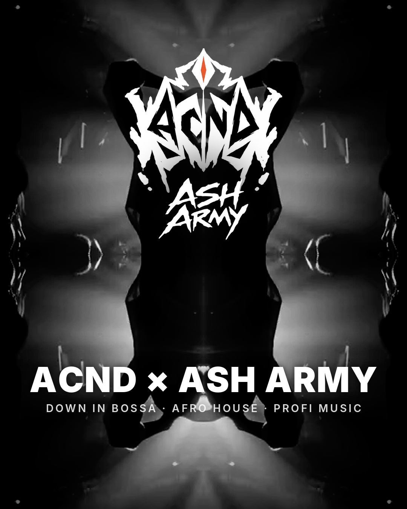 | [With logos](banners/post3.png?raw=1) | [No logos](banners/post3_nologo.png?raw=1) |
| 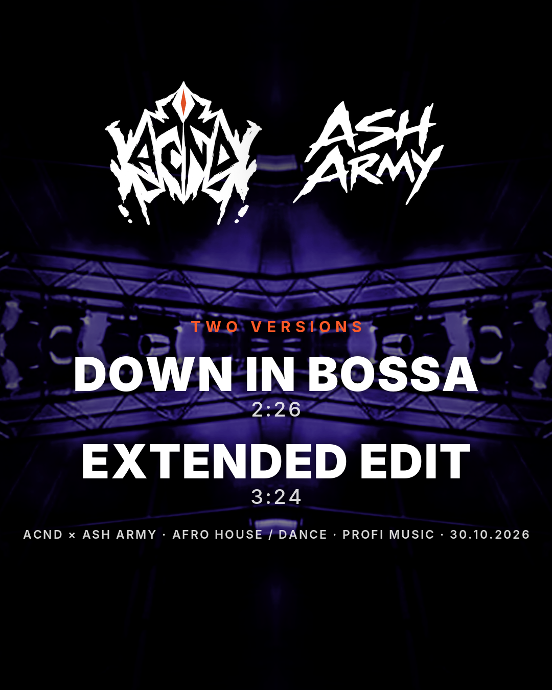 | [With logos](banners/post4.png?raw=1) | [No logos](banners/post4_nologo.png?raw=1) |
| 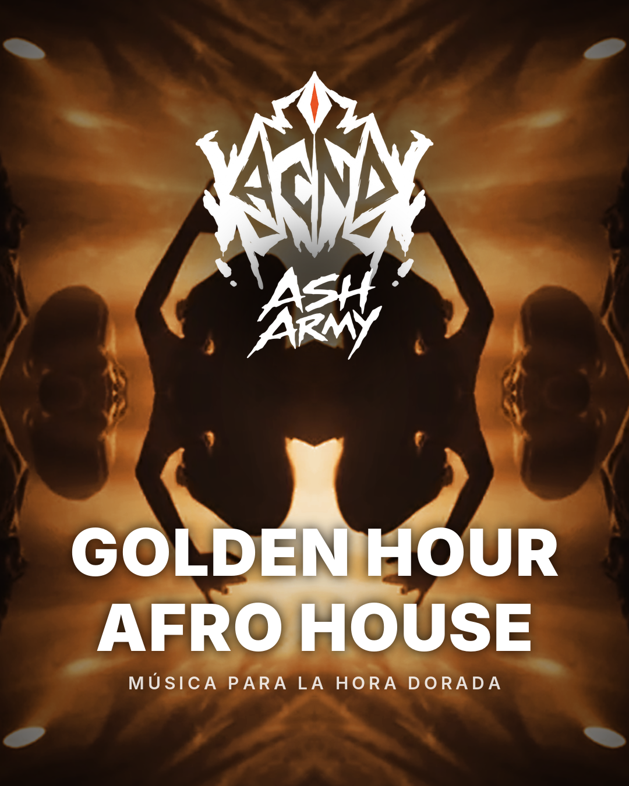 | [With logos](banners/post5.png?raw=1) | [No logos](banners/post5_nologo.png?raw=1) |

## Credits

Down In Bossa by ACND × Ash Army, released on Profi Music. Visuals: ACND HQ.
